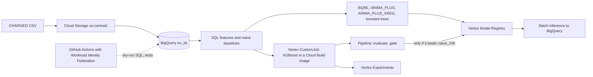
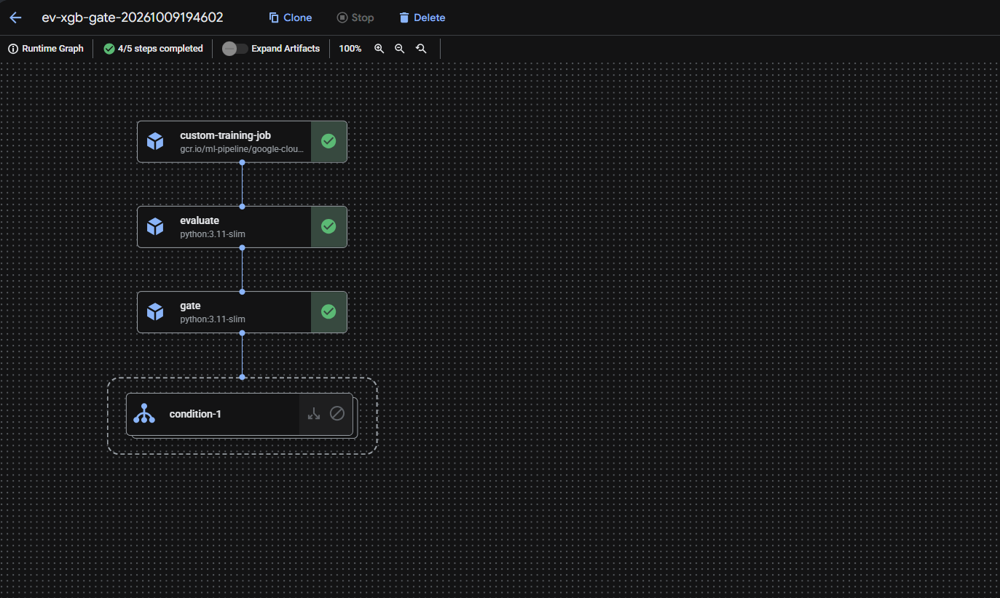
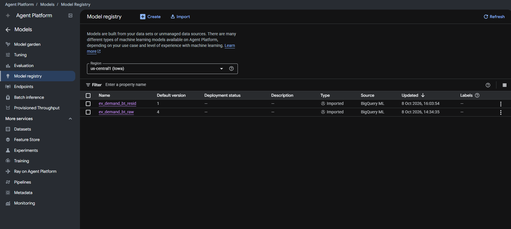
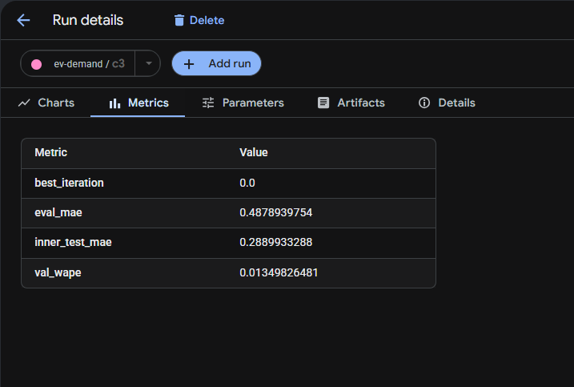

# Day-ahead EV charging demand forecasting on GCP

Hourly, day-ahead charging demand for 1,388 Amsterdam charging sites (CHARGED dataset plus weather), built with BigQuery ML and Vertex AI (now "Gemini Enterprise Agent Platform"), with a promotion gate in front of the model registry.

**Result in one line: XGBoost ties the "same hour yesterday" baseline, and the pipeline gate correctly blocked it. Both facts are the result.**

| September 2023 test (read once) | Site WAPE |
|---|---|
| `xgb_resid` (XGBoost on the residual) | **0.0078** |
| `naive_24h` (same hour yesterday, the gate) | **0.0080** |

The 0.0002 gap goes in opposite directions on August (0.0135 vs 0.0133) and September, and I did not test whether it is more than noise. So this is a tie, not a win. The project's value is the engineering around the model: a leakage-safe split, a frozen test month, a gate that refuses to register a model that does not beat the baseline, and keyless CI.

## Problem and why it matters

Charging operators and grid planners need to know how much energy EVs will draw tomorrow, hour by hour. Too little capacity means queues and grid stress, too much means wasted cost. The task here is a 24 h-ahead forecast per site, issued at midnight, so every input feature is at least 24 h old.

The baseline is hard. The series look smoothed (31% of training site-hours repeat the previous hour exactly, lag-24 correlation 0.979), so "same as yesterday" is almost the answer, and a model has to beat it to be worth running.

## Data

- **Source:** the [CHARGED](https://github.com/IntelligentSystemsLab/CHARGED) dataset, Amsterdam subset (hourly charging volume per site, plus hourly weather), April to September 2023. 1,388 sites x 4,392 hours = 6,096,096 site-hour rows.
- **Splits (time-based, no random split):** training to July, **August = validation**, **September = test**. The test month was scored once, after the git tag `freeze-xgboost-model`.
- **Licence:** the sources disagree (CC-BY-4.0 on Zenodo, MIT for the code, CC BY-NC-ND 4.0 in the article). This repo publishes **code and metrics only**. The data is not redistributed. To reproduce, download CHARGED yourself and attribute its authors.
- **Data problems found and documented** (`docs/data-notes.md`): the `volume` column fails a sanity check (15.69 kWh per charger-hour, and the file total disagrees with `info.csv`), so it is probably not literal kWh. WAPE (scale-free) is the headline metric, and MAE is in unverified units. Source timestamps are local Amsterdam time (confirmed by solar radiation peaking at 13:00) and are stored as UTC.

## Architecture

## Results

WAPE = sum of absolute errors divided by the sum of actuals. Site-pooled, bucket "all". Lower is better. Val = August, test = September. Rows per model: 1,032,672 (val) and 999,360 (test), no null predictions.

| Model | Val WAPE | Test WAPE | Test MAE |
|---|---|---|---|
| `xgb_resid` (custom job, XGBoost) | 0.0135 | **0.0078** | 0.259 |
| `naive_24h` (the gate) | **0.0133** | 0.0080 | 0.264 |
| `bt_resid` (BQML boosted tree, residual label) | 0.0208 | 0.0161 | 0.534 |
| `naive_168h` (same hour last week) | 0.0538 | 0.0318 | 1.050 |
| `naive_4wk` | 0.1422 | 0.0723 | 2.390 |
| `bt_raw` (BQML boosted tree, raw label) | 0.0900 | 0.1293 | 4.276 |
| `arima_plus` (one 744 h forecast) | 0.1114 | not scored | n/a |

What this says:

- **Nothing beats `naive_24h` by a margin.** `xgb_resid` ties it. The two BQML trees are worse. `bt_raw` is the worst on test, because a tree has to re-learn "same as yesterday" from scratch.
- **Predicting the residual helps.** Predicting `energy_kwh - lag_24h` (and adding `lag_24h` back) cut the tree error a lot (`bt_raw` 0.1293 to `bt_resid` 0.0161 on test).
- **XGBoost kept one tree** (`best_iteration` 0): every extra tree made the August check worse. Likely reading: what is left after "same as yesterday" is mostly noise a tree cannot learn. Not tested further.
- **City-level WAPE is much smaller** (`naive_24h` and `xgb_resid` are both 0.0014 on test) because errors cancel when summed across sites.
- **Weather did not help.** On the city series, `ARIMA_PLUS_XREG` with six weather regressors is worse than plain `ARIMA_PLUS` on both val and test. This is with *actual* weather as the "forecast", so it is an upper bound on any weather benefit. `ML.GLOBAL_EXPLAIN` agrees: `lag_24h` carries about 7x the importance of the next feature, and weather features rank low.

Full tables, tuning trials and the explainability output are in [docs/results.md](docs/results.md).

## What ran where

| Step | Where |
|---|---|
| Reshape, UTC conversion, Parquet | local Python (`scripts/prepare_charged.py`) |
| Features, baselines, scoring | BigQuery SQL (`sql/`) |
| `ARIMA_PLUS`, `ARIMA_PLUS_XREG`, boosted trees (tuned, 10 trials each), explain | BigQuery ML |
| Registry and batch inference of the BQML tree | Vertex AI |
| XGBoost training | Vertex CustomJob, own container (Cloud Build to Artifact Registry), CPU only |
| Experiment tracking, model registry, pipeline | Vertex Experiments, Model Registry, Pipelines (KFP) |

The training container is custom because the prebuilt training images were past their end-of-availability date when this was built.

## MLOps: pipeline, gate, registry, CI

`train (CustomJob) -> evaluate -> gate -> register only if the gate passes` ([pipelines/pipeline.py](pipelines/pipeline.py)).

- `evaluate` recomputes validation WAPE from the BigQuery prediction table and checks it against the container's own number.
- `gate` reads the `naive_24h` validation WAPE live from `ev_ds.metrics` and passes only if the candidate is **below** it. Every decision is written to `ev_ds.gate_log`.

| Run | Candidate | Threshold | Decision | Registered |
|---|---|---|---|---|
| Honest | 0.013498 | 0.013332 (`naive_24h`) | **block** | nothing |
| **Forced demo** | 0.013498 | 0.05 (override) | pass | `ev_demand_xgb_resid_forced_demo`, label `gate=forced` |

*Honest run: `gate` returned "block", so the `condition-1` branch (which holds `register`) was skipped. "4/5 steps completed" is the skipped branch, not a failure.*

**The forced run overrides the gate only to prove that the register branch works. It is not a win, and the registered model is a demo.** The registry entry carries the label `gate=forced` for that reason.

**CI** (GitHub Actions): dry-runs the SELECT part of six SQL files and runs the preprocessing unit test. It authenticates with Workload Identity Federation (no stored keys, restricted to this repository by its numeric id) as a read-only service account. CI never submits a pipeline. Last green run: 2026-10-10. The WIF pool was deleted at teardown, so later runs fail at the auth step by design (see below).

One `preprocess()` function is the single feature path for training, scoring and serving. It exists because of an earlier lesson with the BigQuery ML trees: BigQuery's `TRANSFORM` is not applied when the registered model is served by Vertex.

## Limitations

- **Oracle weather:** the backtest feeds actual weather as if it were a forecast, so any weather uplift is an upper bound. In production a weather forecast would be used.
- **Short window:** six summer months, one city, one weather series for all sites. No winter, no full-year seasonality.
- **Smoothed series and unclear units:** the data look smoothed and `energy_kwh` is probably not literal kWh. Only relative metrics are trustworthy.
- **Optimistic validation:** the trees and XGBoost were tuned and early-stopped on August, so val numbers are optimistic. September is the honest number.
- **No significance test:** the 0.0002 gaps are not tested, so "tie" is the safe description. A bootstrap over days on the validation month is a next step.
- **Registered XGBoost model is not served.** It returns the *residual*, so serving needs `lag_24h` added back outside the model, and a live prediction test failed on feature names (the saved model remembers column names, the serving container sends none). It is registered, not served. [scripts/endpoint_demo.py](scripts/endpoint_demo.py) shows the failed attempt. The frozen model was not changed after the test month was read.
- **Batch inference mismatch:** Vertex batch scoring of the BQML `bt_raw` tree did not match `ML.PREDICT` (MAE 7.02 vs 3.27, correlation 0.98). The cause is not isolated: the registry holds only version `@4`, created before training finished, and its weights cannot be verified. The planned breakdown by hour, weekday and temperature was not run.
- **One model family, one hyperparameter set** for XGBoost (copied from the best `bt_resid` trial, not re-tuned). Several best trials sat at the edge of the search range.
- **Licence:** ambiguous across sources, so the data is not redistributed.

**Next steps:** weather forecasts as covariates, a serving fix (save the booster without feature names and add `lag_24h` back outside the model) with a serving test in CI, Model Monitoring (`ML.VALIDATE_DATA_DRIFT`), a bootstrap significance test on the validation month.

## Reproduce and teardown

Needs a GCP project with billing (a Free Trial works), `gcloud`, `bq`, Python 3.12, and your own copy of the CHARGED Amsterdam files.

1. `scripts/prepare_charged.py` reshapes and converts the CSVs to Parquet. Upload to a `us-central1` bucket and `bq load` into a US-multi-region dataset `ev_ds`.
2. Run the SQL in `sql/` in numeric order (`05` verify, `10` features, `20` baseline, `30`-`37` models and scoring, `40` evaluate, `50`-`53` city series, `60` batch input). Dry-run each first and cap bytes with `--maximum_bytes_billed`.
3. `infra/setup.ps1` enables the APIs, creates the Artifact Registry repo, the two service accounts with scoped roles, and the Workload Identity Federation pool for CI (edit `$BUCKET` and `$GH_REPO` at the top first).
4. Build the image with `gcloud builds submit training/` and run `pipelines/pipeline.py` (add `--threshold-override 0.05` for the labelled forced run).
5. `scripts/predict_test.py` scores the test month from the frozen model, once.

Tests: `python -m pytest -q tests` (needs `GCP_PROJECT` set for the SQL dry runs).

**Teardown:** `infra/teardown.ps1` (a dry run unless you pass `-Execute`) deletes endpoints, registry models, the Artifact Registry repo, run artifacts in the bucket, the Vertex Experiment, the WIF pool and both service accounts. The BigQuery dataset and its models stay (free tier), and the raw data stays in the bucket. BigQuery ML models registered in Vertex cannot be deleted from Vertex, so they remain listed there at no cost. After teardown a re-run needs `infra/setup.ps1` first, and CI cannot authenticate until WIF is recreated.

## Licence

The code in this repository is released under the [MIT licence](LICENSE). The CHARGED data is not included and keeps its own licence (see Data above).

## Attribution

CHARGED dataset: Intelligent Systems Lab, see the repository and article linked above. Weather in CHARGED comes from Visual Crossing. This project is independent and not affiliated with the dataset authors.
